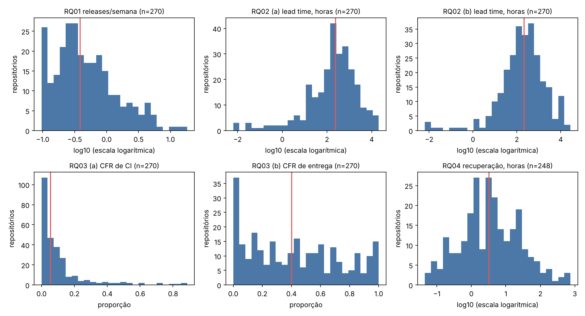
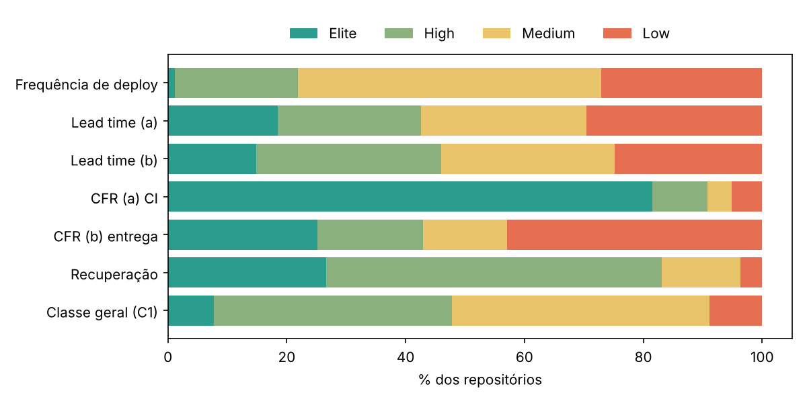
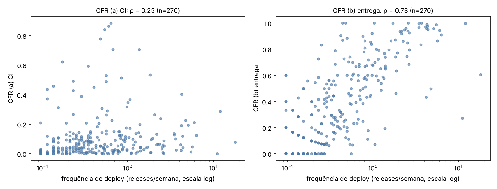
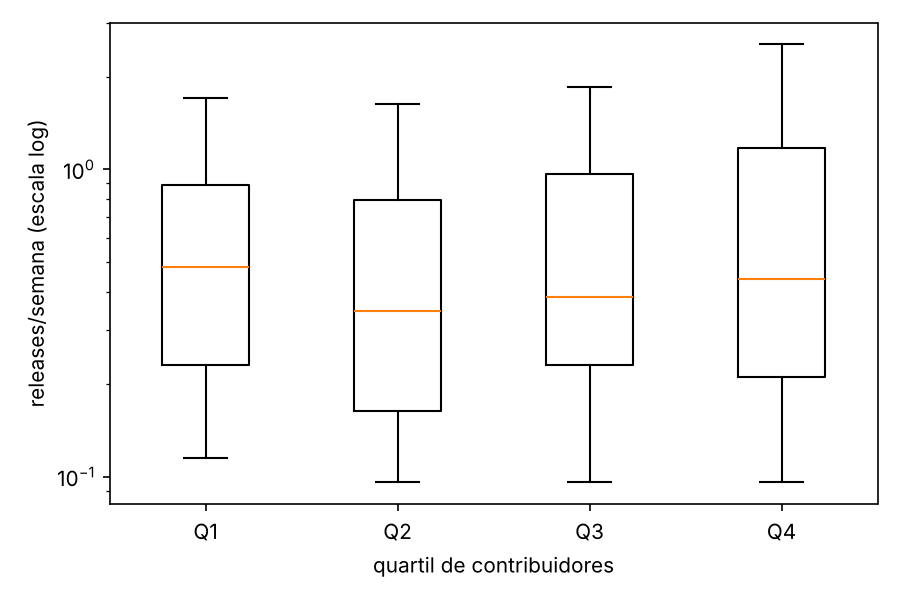

# Mineração de métricas DORA em repositórios populares do GitHub

**Matheus, Pedro e Murilo** · Laboratório de Experimentação de Software · PUC Minas

> Versão consolidada do relatório (Sprint 3). Montada a partir dos textos em `docs/artigo/` e dos números de `data/saida/analise/`. Passa do limite de 10 páginas do modelo SBC: antes de enviar, enxugue e leve para o template do Overleaf. A seção 4.4 (replicação cruzada) continua pendente.

## Resumo

Medimos quatro métricas DORA (frequência de deploy, lead time, taxa de falha e tempo de recuperação) em 270 repositórios populares do GitHub com GitHub Actions, usando como proxies as releases, os commits e as execuções de workflow entre 01/10/2025 e 30/09/2026. A mediana de frequência foi de 0,38 releases por semana, e o lead time ficou perto de nove dias. A taxa de falha depende da definição: 5,3% quando medida pelo CI e 40,0% quando medida pelas releases corretivas, que identificamos com uma heurística validada manualmente (kappa de Fleiss de 0,74 para release corretiva e 0,85 para tipo de projeto; F1 de 0,704 na amostra e 0,697 em validação cruzada). Idade e número de contribuidores se associam ao desempenho; estrelas e tipo de projeto, não. Trocar a definição operacional muda a classe DORA de 19% a 45% dos repositórios.

## Abstract

We measured the four DORA metrics (deployment frequency, lead time, change failure rate and time to restore) on 270 popular GitHub repositories that use GitHub Actions, using releases, commits and workflow runs as proxies (2025-10-01 to 2026-09-30). The median frequency is 0.38 releases per week and the median lead time is about nine days. The change failure rate depends on its definition: 5.3% from CI and 40.0% from corrective releases, flagged by a heuristic validated against manual labels (F1 0.704 in-sample, 0.697 under cross-validation). Repository age and number of contributors are associated with performance; stars and project type are not. Changing the operational definition moves 19% to 45% of repositories to another DORA class.

## 1 Introdução

As métricas DORA (frequência de deploy, lead time para mudanças, taxa de falha em mudanças e tempo de recuperação) são a referência mais usada para medir o desempenho de entrega de software (Forsgren, Humble e Kim, 2018). Elas foram definidas para equipes que sabem quando fazem deploy e quando algo falha. Em repositórios públicos não há esse registro: é preciso aproximar os eventos a partir do que o GitHub expõe, e cada aproximação muda o resultado.

Este trabalho aplica as quatro métricas a repositórios populares que usam GitHub Actions e pergunta quanto a resposta depende da definição escolhida. Respondemos a sete questões de pesquisa e a uma questão bônus:

- **RQ01.** Qual a frequência de deploys?
- **RQ02.** Qual o tempo entre um commit e seu deploy (lead time)?
- **RQ03.** Qual a taxa de falha das mudanças?
- **RQ04.** Quanto tempo leva a recuperação depois de uma falha?
- **RQ05.** Maior frequência de deploy se associa a maior ou menor taxa de falha?
- **RQ06.** Que características dos repositórios se associam ao desempenho DORA?
- **RQ07.** Quanto a classificação DORA depende da definição operacional?
- **RQ08 (bônus).** Qual a taxa de retrabalho (*rework rate*)?

### 1.1 Hipóteses

As hipóteses foram escritas antes da coleta dos dados e estão em `docs/hipoteses_*.md`. A seção 4.1 as compara com os resultados.

#### RQ01 — Frequência de deploys

**Pergunta:** Qual a frequência de deploys dos repositórios populares que usam CI/CD?

**Hipótese:** Esperamos que a mediana fique entre 1 release por mês e 1 por semana (faixas Medium/High), com poucos repositórios Elite (7 ou mais por semana) e uma cauda longa de projetos muito ativos. O motivo é que publicar uma release no GitHub é um ato deliberado (criar tag, escrever notas), e os repositórios populares costumam ser bibliotecas e ferramentas com versionamento em ciclos de semanas. Projetos com deploy contínuo raramente publicam uma release a cada deploy, então a métrica tende a subestimá-los. O filtro de pelo menos 5 releases em 12 meses também elimina os projetos mais parados.

#### RQ02 — Lead time

**Pergunta:** Qual o tempo entre um commit e seu respectivo deploy?

**Hipótese:** Esperamos que a variante (b), por commit, dê valores bem menores que a (a), por release, na grande maioria dos repositórios, com mediana de (b) em dias e de (a) em semanas (faixas Medium/Low). A razão é que uma release reúne todos os commits acumulados desde a anterior: a variante (a) olha só o mais antigo e basta um commit "esquecido" para ela explodir, enquanto a (b) pesa todos os commits e é dominada pelos mais recentes. Também esperamos que repositórios com releases mais frequentes tenham lead time menor, em parte por efeito mecânico (menos tempo para os commits esperarem).

#### RQ03 — Taxa de falha

**Pergunta:** Qual a taxa de falha das mudanças entregues por esses repositórios?

**Hipótese:** Esperamos que o CFR (a), de CI, tenha mediana entre 10% e 30%, e que o CFR (b), de entrega, seja menor na mediana, com muitos repositórios em 0%. Falhar um pipeline é barato e comum (testes instáveis, dependências quebradas, runs em branches de trabalho), enquanto uma release corretiva em até 7 dias exige esforço e só acontece quando o defeito é percebido e importante. Por isso esperamos também que as duas variantes se correlacionem pouco: elas medem coisas diferentes, falha de pipeline e correção de entrega.

#### RQ04 — Tempo de recuperação

**Pergunta:** Qual o tempo de recuperação após uma execução de CI/CD com falha?

**Hipótese:** Esperamos uma distribuição muito assimétrica: a maioria dos episódios resolvida em menos de 24 horas, porque falha na branch principal é visível e os mantenedores corrigem logo, mas com uma cauda longa de workflows secundários (nightly, publicação de documentação) que ficam quebrados por semanas. Por isso a mediana por repositório deve ficar entre algumas horas e poucos dias, e esperamos uma proporção de episódios censurados que não é desprezível em parte dos repositórios.

#### RQ05 — Frequência × taxa de falha

**Pergunta:** Repositórios com maior frequência de deploy apresentam maior ou menor taxa de falha?

**Hipótese:** Esperamos uma correlação de Spearman perto de zero (ou levemente negativa) entre frequência e CFR (a): projetos que publicam com frequência tendem a ter CI mais maduro, mas isso não deve ser uma regra forte. Para o CFR (b) esperamos uma correlação positiva fraca ou moderada, em parte mecânica: quanto mais releases, maior a chance de alguma delas ser corretiva e cair dentro dos 7 dias seguintes. Portanto não esperamos confirmar a tese do DORA de que velocidade e estabilidade andam juntas; esperamos ausência de trade-off claro, e não uma relação inversa forte.

#### RQ06 — Características dos repositórios

**Pergunta:** Quais características dos repositórios estão associadas a um melhor desempenho DORA?

**Hipótese:** Esperamos que o número de contribuidores esteja associado a maior frequência de deploy (mais gente, mais releases), e que o tipo do projeto importe: aplicações, serviços e ferramentas CLI devem publicar com mais frequência que bibliotecas e frameworks, que costumam agrupar mudanças em versões semânticas. Esperamos pouca ou nenhuma associação com popularidade (estrelas), e diferenças de linguagem ligadas a convenções de cada ecossistema. Depois da correção de Holm esperamos que só uma minoria dos testes continue significativa, com tamanhos de efeito pequenos a médios.

#### RQ07 — Sensibilidade à definição

**Pergunta:** O quanto a classificação DORA de um repositório depende da definição operacional escolhida?

**Hipótese:** Esperamos que a classificação DORA dependa bastante da definição escolhida: pelo menos 40% dos repositórios devem mudar de categoria entre C1 e C3 (usar tags em vez de releases altera muito a frequência) e o kappa ponderado deve ficar abaixo de 0,6. Esperamos que C1 e C2 sejam mais parecidas entre si, já que pré-releases são raras, embora a troca das variantes de lead time e CFR já mude parte dos repositórios. Em resumo, a ordem relativa dos repositórios (quem é mais ou menos frequente) deve ser robusta, mas as faixas absolutas Elite/High/Medium/Low não.

## 2 Metodologia

### 2.1 Fonte de dados

Todos os dados vêm da API REST do GitHub, acessada por um cliente HTTP escrito pelo grupo (sem bibliotecas prontas de acesso à API). Foram usados os endpoints de busca de repositórios, workflows, releases, comparação de commits (`compare`), workflow runs e contribuidores. A coleta foi executada em 14 e 15 de outubro de 2026 com token autenticado, e todas as respostas ficam em um cache local, o que torna a coleta retomável e auditável.

### 2.2 Janela de observação

A janela tem 12 meses, de 1º de outubro de 2025 a 30 de setembro de 2026 (UTC), fixada pelo professor. Só entram nos cálculos releases publicadas e workflow runs criados dentro dela. A primeira release da janela pode ter como release anterior uma publicada antes do início; isso é permitido apenas para obter os commits que ela inclui.

### 2.3 Seleção dos repositórios e funil

**Candidatos.** A Search API devolve no máximo 1.000 resultados por consulta. Para contornar esse limite, a busca foi fatiada em faixas de estrelas (`stars:1000..1199`, `1200..1499`, ..., `>=50000`), sempre com `fork:false archived:false`. Os resultados das faixas foram unidos sem duplicatas. Os candidatos são repositórios com mais de 1.000 estrelas.

**Ordem de processamento.** Os candidatos foram processados em ordem pseudoaleatória reprodutível (ordenação por hash SHA-256 de `semente:repositório`, com semente 42), até atingir o alvo da amostra. Isso evita que a amostra seja dominada pelos repositórios mais estrelados, mas a amostra continua restrita aos candidatos devolvidos pela busca (veja a ameaça de validade externa).

**Filtros, na ordem:**
1. o repositório usa GitHub Actions (`total_count > 0` em `/actions/workflows`);
2. tem pelo menos 5 releases principais publicadas na janela (rascunhos e pré-releases não contam);
3. tem pelo menos 50 workflow runs válidos (`success` ou falha, ver 2.4) no default branch, evento `push`, dentro da janela.

**Funil.** A tabela abaixo é gerada automaticamente pelo pipeline (`data/saida/funil_selecao.md`).

A busca devolveu **8.499 candidatos**. O pipeline os processa em ordem pseudoaleatória e parou ao chegar a **270 repositórios na amostra final**, depois de examinar **1.391** candidatos (os outros 7.108 não foram examinados). O alvo de 350 não foi alcançado e o mínimo de 300 do enunciado também não; as análises usam os 270 repositórios disponíveis (ver ameaças à validade). Como os candidatos foram examinados em ordem aleatória, as taxas de passagem abaixo estimam o que aconteceria com os 8.499.

| Etapa | Repositórios |
|---|---|
| candidatos devolvidos pela busca (≥ 1.000 estrelas) | 8.499 |
| examinados antes de a coleta parar | 1.391 |
| usam GitHub Actions | 941 |
| ≥ 5 releases na janela | 349 |
| ≥ 50 workflow runs válidos (amostra final) | 270 |

| Motivo de descarte (entre os 1.391 examinados) | Repositórios |
|---|---|
| não usam GitHub Actions (`sem_actions`) | 450 |
| menos de 5 releases na janela (`releases_insuficientes`) | 592 |
| menos de 50 workflow runs válidos (`runs_insuficientes`) | 78 |
| em processamento quando a coleta parou | 1 |

Entre os examinados, 68% usam Actions (941 de 1.391); entre os que usam, 37% têm releases suficientes (349 de 941); entre esses, 77% têm runs suficientes (270 de 349).

### 2.4 Definições operacionais

| Conceito | Definição adotada |
|---|---|
| Deploy | release publicada (`draft = false`, `prerelease = false`) |
| Branch | apenas o `default_branch` do repositório |
| Data de um commit | `commit.author.date` |
| Execuções de CI | workflow runs com `event = push` no default branch |
| Sucesso | `conclusion = success` |
| Falha | `failure`, `timed_out`, `startup_failure` |
| Ignorado | `cancelled`, `skipped`, `neutral`, `action_required`, `stale` ou vazio; não entra em nenhum cálculo, mas é contado (`n_runs_ignorados`) |
| Censura | medições cujo evento final não ocorre na janela são mantidas e contadas, nunca descartadas |

**Métricas e variantes calculadas nesta etapa** (todas no mesmo dataset, uma linha por repositório):

- **Frequência de deploy (RQ01):** releases na janela ÷ 52,1 semanas.
- **Lead time (RQ02):** variante (a), por release: data da release menos o commit mais antigo incluído nela; variante (b), por commit: um valor por commit. Em ambas, a mediana do repositório é calculada sobre as releases (a) ou sobre todos os commits (b). A primeira release da história é ignorada.
- **CFR (RQ03):** variante (a), por CI: falhas ÷ (falhas + sucessos); variante (b), por entrega: releases seguidas, em até 7 dias, por uma release corretiva ÷ releases avaliadas. As releases dos últimos 7 dias da janela ficam fora do denominador (censura).
- **Tempo de recuperação (RQ04):** por workflow, um episódio começa na primeira falha após um sucesso e termina no próximo sucesso do mesmo workflow; tempo = `updated_at` do sucesso menos `run_started_at` da falha. Reportamos a mediana dos episódios concluídos e, separadamente, a mediana que inclui os censurados como limite inferior.
- **Classificação DORA (RQ07, combinação C1):** cada métrica recebe 4 (Elite), 3 (High), 2 (Medium) ou 1 (Low) pelos cortes da disciplina; a classe geral é a mediana dos pontos, arredondada para baixo. Métricas sem valor ficam fora da mediana.

As combinações da RQ07 (C1 a C4) estão descritas na seção de resultados e usam o arquivo `data/saida/dataset_sensibilidade.csv`. A coleta **não baixou as tags** do GitHub, então a combinação com tags como unidade de entrega do exemplo do enunciado não pôde ser calculada.

### 2.5 Estatística descritiva

Em todas as RQs reportamos mediana e intervalo interquartil (IQR), e não média e desvio-padrão, porque as distribuições dessas métricas são muito assimétricas.

### 2.6 Amostra-ouro

A heurística automática de release corretiva pode errar, e a única forma de medir o quanto é comparar com o julgamento de pessoas. Para isso, sorteamos 60 repositórios da amostra final com semente fixa (`df.sample(n=60, random_state=42)`) e, em cada um, 5 releases principais que têm release anterior (sorteio reprodutível com semente derivada de `42:repositório`). A planilha de cada avaliador traz links diretos para a página da release e para a comparação entre releases, e **não** contém a saída da heurística.

### 2.7 Rotulagem independente

Os três autores rotularam, cada um sozinho e sem consultar os demais, três dimensões:

1. **tipo do projeto**: biblioteca/framework, aplicação/serviço, ferramenta CLI ou outro (usado na RQ06);
2. **as releases representam entregas reais ao usuário?** sim, não ou incerto;
3. **a release é corretiva?** sim ou não, lendo as notas da release e a lista de commits (60 repositórios × 5 releases = 300 releases).

### 2.8 Concordância entre avaliadores

Calculamos o kappa de Fleiss por dimensão (`statsmodels`: `aggregate_raters` e `fleiss_kappa`) e a concordância bruta, e interpretamos o kappa pela escala de Landis e Koch (1977). O kappa corrige a concordância esperada por acaso, por isso é mais informativo que a porcentagem de acordos.

| Dimensão | n de itens | Kappa de Fleiss | Interpretação | Concordância bruta |
|---|---|---|---|---|
| tipo do projeto | 60 | 0,849 | quase perfeita | 85,0% |
| releases são entregas reais | 60 | 0,122 | leve | 83,3% |
| release corretiva | 300 | 0,739 | substancial | 80,7% |

O kappa de "entregas reais" é baixo apesar de 83% de concordância bruta por causa da distribuição muito desbalanceada dos rótulos: no consenso, 58 dos 60 repositórios são "sim", um é "não" e um é "incerto". Quando quase tudo é "sim", o acordo esperado por acaso é altíssimo e qualquer divergência derruba o kappa (o chamado paradoxo do kappa). Por isso essa dimensão não discrimina repositórios e não entra nas análises; o resultado indica que, para os avaliadores, praticamente todas as releases dos repositórios amostrados representam entregas. Para "release corretiva", houve unanimidade em 242 das 300 releases (81%), e a divergência é um pouco maior nas releases com 20 commits ou mais (22%) do que nas menores (17%), o que é compatível com releases que misturam correções e novidades, mas a diferença é pequena. Para tipo do projeto, houve unanimidade em 51 dos 60 repositórios.

### 2.9 Consenso e protocolo de desempate

O rótulo de consenso é a **maioria simples (2 de 3)**. Casos sem maioria (1-1-1) são decididos em reunião dos três autores e registrados em `rotulos/desempate_reuniao.csv`. Houve **um** caso de desempate: o repositório `zephyrproject-rtos/zephyr` (tipo do projeto), decidido em reunião como `outro`. Os demais 59 repositórios e as 300 releases tiveram maioria de 2 em 3.

### 2.10 Heurística de release corretiva (RQ03 b)

Testamos cinco versões, todas aplicadas a uma release R, sua release anterior e os commits entre elas:

| Versão | Regra |
|---|---|
| v1 (baseline do enunciado) | bump de *patch* (mesmo MAJOR.MINOR da anterior e PATCH maior) **ou** algum commit com `revert`, `hotfix` ou `fix` na mensagem (palavras inteiras: `prefix` não conta) |
| v2 (conservadora) | bump de *patch* **e** pelo menos um commit com essas palavras |
| v3 | bump de *patch* com até 5 commits ou com commit de correção; releases *minor/major* só se pelo menos 50% dos commits forem de correção |
| v4 (refinada) | ignora commits de *merge* e de dependência (`bump`, `deps`, `dependabot`); corretiva se for *patch* com correção (ou com até 2 commits úteis) ou se pelo menos 30% dos commits úteis forem de correção |
| v5 (refinada) | v4, ou release com commit de correção publicada em até 2 dias depois da release anterior |

Cada versão foi comparada com o consenso por precisão, recall e F1 (`scikit-learn`, `precision_recall_fscore_support`, classe positiva = corretiva). A meta era F1 ≥ 0,70.

| Versão | Precisão | Recall | F1 | Observação |
|---|---|---|---|---|
| v1 | 0,469 | 0,970 | 0,633 | marca 277 de 300 releases como corretivas |
| v2 | 0,643 | 0,687 | 0,664 | |
| v3 | 0,594 | 0,754 | 0,664 | |
| v4 | 0,600 | 0,806 | 0,688 | |
| v5 | 0,600 | 0,851 | **0,704** | versão adotada |

Nenhuma das versões do enunciado (v1 a v3) atingiu 0,70. Na v1, a palavra `fix` aparece em quase toda release (inclusive em `fix(deps)` de atualização automática de dependência), então a heurística marca 92% das releases e tem precisão de 0,47. A v4 remove esse ruído e passa a exigir uma fração de commits de correção, e a v5 acrescenta o intervalo curto desde a release anterior, que no consenso é um sinal de correção (53% das releases publicadas em até 1 dia depois da anterior são corretivas, contra 36% quando o intervalo passa de 14 dias).

Como os limiares da v4 e da v5 foram escolhidos nos mesmos 300 rótulos em que a F1 é medida, repetimos a escolha dentro de uma validação cruzada por repositório (5 dobras): a F1 da v5 fora da amostra é **0,697**, ou seja, a meta de 0,70 é atingida na amostra-ouro mas não de forma robusta. A precisão de 0,60 significa que 4 em cada 10 releases marcadas como corretivas não são; o CFR (b) e o *rework rate* são, portanto, limites superiores, e isso é tratado como ameaça à validade da RQ03 (b). A heurística só enxerga as mensagens de commit e os números de versão, enquanto os avaliadores leram as notas das releases, o que sugere que esse é o teto com esses sinais.

A versão adotada no dataset final foi a **v5** (F1 = 0,704 na amostra-ouro; 0,697 em validação cruzada). A classificação DORA mudou pouco entre versões da heurística (2% a 13% dos repositórios mudam de categoria; kappa ponderado de 0,79 a 0,97), como mostra a análise de sensibilidade.

### 2.11 Pipeline

O pipeline é executado por um único comando (`python -m pipeline --config config.yaml`); o token do GitHub vem da variável de ambiente `GITHUB_TOKEN` e nunca é commitado. Ele tem quatro camadas:

- **Cliente HTTP:** escrito pelo grupo sobre `requests`. Segue o cabeçalho `Link` (`rel="next"`) para paginar, lê `X-RateLimit-Remaining` e `X-RateLimit-Reset` e espera automaticamente quando a cota está acabando ou o servidor responde 403/429 por limite de taxa. Erros 5xx e de rede são repetidos com *backoff* exponencial (1 s, 2 s, 4 s, 8 s) até 5 tentativas.
- **Cache e retomada:** cada resposta é gravada em SQLite (chave = caminho + parâmetros). Um segundo banco guarda a etapa alcançada por cada repositório e o motivo de descarte. Interromper e rodar de novo continua de onde parou, sem repetir chamadas.
- **Coletores:** releases (com a release anterior de cada uma), commits entre releases (`compare` paginado de 100 em 100) e workflow runs.
- **Métricas:** funções puras, sem acesso à rede, testadas com pytest (196 testes; cobertura de 100% do módulo de métricas, mínimo exigido de 80%), executadas a cada push pelo GitHub Actions do próprio repositório.

### 2.12 Limites da API e como foram tratados

| Limite | Tratamento |
|---|---|
| Busca devolve no máximo 1.000 resultados | consultas fatiadas por faixas de estrelas |
| `compare` devolve no máximo 250 commits sem paginação | paginação até 30 páginas; releases com mais commits ficam marcadas como `truncado` e entram no dataset com essa marca |
| Workflow runs: no máximo 1.000 resultados por consulta com filtros | janela dividida por mês e, se algum intervalo atinge o teto, dividida ao meio recursivamente; se ainda assim atinge o teto, a coluna `teto_runs_atingido` fica verdadeira |
| `compare` retorna 404/422 (tag removida ou reescrita) | a release é marcada `indisponivel` e fica fora do lead time, contada em `n_releases_indisponiveis` |
| Lista de contribuidores recusada em repositórios muito grandes | `contribuidores` fica vazio |

### 2.13 Tratamento de casos de borda

- Release sem release anterior (primeira da história): fora do lead time (`n_releases_sem_anterior`).
- Release sem commits novos: fora do lead time (`n_releases_sem_commits`).
- Commit com data posterior à release (efeito de *rebase* ou *squash*): mantido nos cálculos e contado em `n_lead_negativos`.
- Falha sem sucesso anterior no mesmo workflow: não inicia episódio.
- Execuções `cancelled` e similares: ignoradas e não encerram episódios.
- Episódio de falha nunca recuperado na janela: censurado; reportamos `n_episodios_censurados` e `prop_episodios_censurados`.

### 2.14 Dataset final

O arquivo `data/saida/dataset_dora.csv` tem uma linha por repositório e 37 colunas, com todas as variantes de RQ01 a RQ04, os contadores de censura e de exclusão e a classe DORA da combinação C1. O dicionário de dados (nome, tipo, unidade e fórmula ou origem de cada coluna) está em `docs/DICIONARIO_DADOS.md` e em `data/saida/dicionario_dados.csv`, gerado da mesma fonte que as colunas do CSV, o que impede que os dois divirjam.

A amostra final tem **270 repositórios** (o mínimo exigido era 300; ver ameaças à validade), de 25 linguagens (TypeScript 73, Python 46, Go 38, Rust 25, JavaScript 19), com mediana de 15.705 estrelas (IQR 4.816 a 36.418), 168 contribuidores (IQR 64 a 466) e 6,6 anos de idade (2.394 dias). Os 270 repositórios somam 13.664 releases publicadas, 1.046.247 commits comparados e cerca de 800 mil workflow runs válidos. Pré-releases (4.119 em 98 repositórios) ficam fora da definição principal. Do total de releases, 58 são a primeira da história (sem release anterior), 12 tiveram o `compare` indisponível e 1.659 (12%) não trouxeram commits novos; todas ficam fora do lead time. Em 22 repositórios existe commit com data posterior à release (`n_lead_negativos`), efeito de *rebase* ou *squash*; eles foram mantidos.

### 2.15 Reprodutibilidade

Com a mesma janela, a mesma semente (42) e o mesmo cache, a seleção e as métricas são determinísticas. Sem o cache, repetir a coleta pode produzir números ligeiramente diferentes, porque repositórios recebem estrelas, releases e runs ao longo do tempo; por isso o cache e o dataset final são versionados ou arquivados junto com o artigo.

## 3 Resultados

### 3.1 Visão geral

| RQ | Métrica | n | Mediana | Q1–Q3 |
|---|---|---|---|---|
| RQ01 | Frequência de deploy (releases/semana) | 270 | 0,38 | 0,21–0,88 |
| RQ02 (a) | Lead time por release (horas) | 270 | 235,6 (9,8 dias) | 60,2–890,2 |
| RQ02 (b) | Lead time por commit (horas) | 270 | 212,8 (8,9 dias) | 55,2–706,7 |
| RQ03 (a) | CFR de CI | 270 | 5,3% | 1,7%–12,2% |
| RQ03 (b) | CFR de entrega (v5) | 270 | 40,0% | 14,6%–66,7% |
| RQ04 | Tempo de recuperação (horas) | 248 | 3,2 | 0,9–15,4 |

### 3.2 RQ01: frequência de deploy

A mediana é de 0,38 releases por semana (cerca de uma release a cada 18 dias), com IQR de 0,21 a 0,88. A distribuição é assimétrica: o máximo é de 18,1 por semana e só 22% dos repositórios publicam pelo menos uma release por semana. Pelos cortes da disciplina, 3 repositórios (1,1%) são Elite, 56 (20,7%) High, 138 (51,1%) Medium e 73 (27,0%) Low.

### 3.3 RQ02: lead time

A mediana por release (a) é de 9,8 dias e a por commit (b) é de 8,9 dias. As duas variantes divergem, mas menos do que esperávamos: (a) é maior que (b) em 63% dos repositórios, e a razão mediana entre elas é de 1,28 (Wilcoxon pareado, p = 1,7 × 10⁻⁴). Entre repositórios, as duas se correlacionam fortemente (Spearman ρ = 0,77). Repositórios que publicam com mais frequência esperam menos: ρ = −0,59 entre frequência e lead time (a) e −0,50 com o (b), em parte por efeito mecânico (com releases mais próximas, os commits têm menos tempo para esperar). Pela variante (a), 50 repositórios (18,5%) são Elite, 65 (24,1%) High, 75 (27,8%) Medium e 80 (29,6%) Low; pela (b), 40 (14,8%), 84 (31,1%), 79 (29,3%) e 67 (24,8%).

**Por que as variantes divergem.** A variante (a) olha só o commit mais antigo de cada release, então um único commit "esquecido" a infla. A variante (b) dá um valor a cada commit, e as releases com muitos commits dominam a mediana. Os dois efeitos se compensam em parte, o que explica a razão de apenas 1,28.

**O que ficou de fora do lead time.** Das 13.664 releases publicadas, 58 são a primeira da história do repositório, 12 tiveram o `compare` indisponível e 1.659 (12%) não trouxeram commits novos. Em 22 repositórios há commits com data posterior à release (efeito de *rebase* ou *squash*), mantidos nos cálculos.

### 3.4 RQ03: taxa de falha

A variante (a), de CI, tem mediana de 5,3% (1,7% a 12,2%): 81,5% dos repositórios são Elite nessa variante (CFR ≤ 15%). A variante (b), de entrega, tem mediana de 40,0% (14,6% a 66,7%) e só 25,2% de Elite, contra 43,0% de Low (CFR > 45%). A (b) é maior que a (a) em 78% dos repositórios, e as duas se correlacionam pouco (ρ = 0,24).

As duas variantes medem coisas diferentes: (a) mede falha de pipeline, e uma falha de CI não chega ao usuário; (b) mede releases seguidas de uma correção em até 7 dias, e depende da heurística de release corretiva (F1 = 0,70, precisão de 0,60). Como a heurística marca mais releases como corretivas do que o consenso humano (63% contra 45% na amostra-ouro), o CFR (b) é um limite superior. As releases dos últimos 7 dias da janela (310 no total) ficaram fora do denominador.

### 3.5 RQ04: tempo de recuperação

A mediana por repositório é de 3,2 horas (0,9 a 15,4), calculada sobre 248 repositórios: 22 não tiveram nenhum episódio de falha seguido de sucesso e ficam sem valor (não são tratados como zero). Foram 20.956 episódios, dos quais 140 (0,7%) foram censurados por não se recuperarem até o fim da janela; eles aparecem em 71 repositórios, mas em só 19 (7%) a censura atinge 10% ou mais dos episódios (máximo de 50%). A mediana que inclui os censurados como limite inferior é igual à mediana dos concluídos (3,2 horas). Pelos cortes da disciplina, 66 repositórios (26,6%) são Elite, 140 (56,5%) High, 33 (13,3%) Medium e 9 (3,6%) Low.

### 3.6 Classificação DORA de referência (combinação C1)

A combinação C1 usa release como unidade de deploy, lead time (a) e CFR (a). A classe geral é a mediana dos pontos das quatro métricas, arredondada para baixo.

| Classe | Repositórios | % |
|---|---|---|
| Elite | 21 | 7,8 |
| High | 108 | 40,0 |
| Medium | 117 | 43,3 |
| Low | 24 | 8,9 |

As métricas puxam a classificação em direções opostas: a frequência de deploy é a métrica mais baixa (só 22% chegam a High ou Elite) e o CFR (a) é a mais alta (91% em High ou Elite). Por isso a classe geral se concentra em High e Medium.

### 3.7 RQ05: frequência de deploy × taxa de falha

| Variante do CFR | n | ρ de Spearman | p | Força |
|---|---|---|---|---|
| (a) CI | 270 | 0,25 | 2,2 × 10⁻⁵ | fraca, positiva |
| (b) entrega (v5) | 270 | 0,73 | 1,8 × 10⁻⁴⁵ | forte, positiva |

Nas duas variantes, **quanto maior a frequência de deploy, maior o CFR**, o oposto do que o DORA sugere. A relação com o CFR (a) é fraca (ρ = 0,25). Com o CFR (b) é forte (ρ = 0,73) e em parte **mecânica**: o CFR (b) conta uma release como falha se outra release corretiva sai em até 7 dias, e quem publica com mais frequência tem mais chance de ter alguma release no intervalo de 7 dias. O gráfico mostra isso nos repositórios de baixa frequência, que ficam em degraus (poucas releases, CFR em frações simples como 0, 1/6 ou 1/3). A correlação positiva aparece com todas as versões da heurística: ρ = 0,75 (v1), 0,52 (v2), 0,67 (v3), 0,68 (v4) e 0,73 (v5). Como a medida (b) tem esse viés, o resultado que deve sustentar a discussão é o da variante (a). Correlação não é causalidade: repositórios com mais releases também têm mais CI, mais contribuidores e mais mudanças em cada janela.

### 3.8 RQ06: características associadas ao desempenho

Cinco fatores (linguagem principal, popularidade, contribuidores, idade, tipo do projeto) contra seis métricas (RQ01 a RQ04 com as duas variantes de lead time e de CFR) deram **30 testes** (Kruskal-Wallis, com ε² como tamanho de efeito), com correção de Holm. Popularidade, contribuidores e idade foram divididos em quartis (68, 67, 67 e 68 repositórios); linguagens com menos de 15 repositórios foram agrupadas em "Outras"; o tipo do projeto existe só para os 60 repositórios da amostra-ouro.

**Nove dos 30 testes continuam significativos depois de Holm (p ajustado < 0,05):**

| Fator | Métrica | ε² | Magnitude | p (Holm) |
|---|---|---|---|---|
| idade | lead time (a) | 0,28 | grande | < 0,001 |
| idade | CFR (b) | 0,26 | grande | < 0,001 |
| idade | lead time (b) | 0,24 | grande | < 0,001 |
| idade | frequência de deploy | 0,16 | grande | < 0,001 |
| contribuidores | lead time (b) | 0,13 | médio | < 0,001 |
| contribuidores | lead time (a) | 0,11 | médio | < 0,001 |
| linguagem | lead time (b) | 0,09 | médio | 0,016 |
| linguagem | lead time (a) | 0,08 | médio | 0,033 |
| idade | tempo de recuperação | 0,06 | pequeno | 0,036 |

Popularidade (estrelas) e tipo do projeto não ficaram significativos em nenhuma métrica. Nos 21 testes restantes os tamanhos de efeito são quase todos desprezíveis ou pequenos. As exceções são a linguagem em relação à frequência (ε² = 0,07, médio) e o tipo do projeto (quatro testes médios e um grande: CFR (a), ε² = 0,18, p = 0,012 antes de Holm e 0,25 depois), que não alcançam significância ajustada, o que é esperado com 60 repositórios em 4 grupos.

**Pós-teste de extremos (Q4 contra Q1, Cliff's δ, Holm).** Os repositórios mais velhos (Q4) têm frequência de deploy menor (mediana de 0,27 contra 0,81 releases/semana; δ = −0,61, grande), lead time (a) maior (733 contra 27 horas; δ = 0,79, grande) e CFR (b) menor (0,23 contra 0,74; δ = −0,75, grande). Os repositórios com mais contribuidores têm lead time maior (693 contra 93 horas no lead time (a); δ = 0,52, grande), mas **não** publicam com mais frequência (δ = 0,00). Por tipo do projeto, aplicações/serviços e CLIs têm mediana de 0,48 e 0,52 releases/semana, contra 0,26 das bibliotecas/frameworks, mas essa diferença não é significativa (p = 0,15 antes de Holm).

**Robustez da idade.** A idade limita o lead time dos repositórios jovens, porque um commit não pode ser mais antigo que o repositório. Há 40 repositórios com menos de um ano de idade (lead time (a) mediano de 20 horas contra 321 horas nos demais). Refazendo o Spearman só com os 230 repositórios de pelo menos um ano, a associação diminui mas persiste: ρ = −0,34 (frequência), +0,38 (lead time (a)), +0,36 (lead time (b)) e −0,28 (CFR (b)). A associação com o tempo de recuperação não persiste (ρ = 0,12, p = 0,083).

### 3.9 RQ07: sensibilidade à definição operacional

Usamos quatro combinações. A combinação com **tags** do exemplo do enunciado não pôde ser calculada porque a coleta não baixou as tags; ela foi substituída por C3.

| Combinação | Unidade de deploy | Lead time | CFR |
|---|---|---|---|
| C1 (referência) | release | (a) | (a) CI |
| C2 | release + pré-release | (b) | (b) entrega |
| C3 | release | (b) | (a) CI |
| C4 | release | (a) | (b) entrega |

Distribuição da classe geral: C1 tem 21 Elite, 108 High, 117 Medium e 24 Low; C2 tem 4, 75, 160 e 31; C3 tem 23, 112, 114 e 21; C4 tem 2, 65, 168 e 35.

| Par | Mudaram de categoria | κ ponderado (linear) | Interpretação |
|---|---|---|---|
| C1 × C2 | 44,8% (121) | 0,37 | razoável |
| C1 × C3 | 18,9% (51) | 0,76 | substancial |
| C1 × C4 | 35,6% (96) | 0,54 | moderada |
| C2 × C3 | 36,7% (99) | 0,52 | moderada |
| C2 × C4 | 22,6% (61) | 0,64 | substancial |
| C3 × C4 | 41,5% (112) | 0,44 | moderada |

Entre 19% e 45% dos repositórios mudam de categoria conforme a definição. A escolha que mais pesa é a variante do CFR: as combinações que usam o CFR (b) (C2 e C4) classificam muito mais repositórios como Medium ou Low do que as que usam o CFR (a). Trocar só o lead time de (a) para (b) (C1 × C3) é a mudança que menos altera a classificação (19%). Já a **ordem relativa** dos repositórios é mais estável do que as faixas: o Spearman entre as pontuações vai de 0,53 (C1 × C2) a 0,82 (C1 × C3). A **frequência de deploy** (RQ01) é pouco sensível à unidade de deploy: contar também as pré-releases (4.119 em 98 repositórios) eleva a mediana de 0,38 para 0,46 releases por semana, e só 21 repositórios (7,8%) mudam de faixa de frequência. A classificação é pouco sensível à versão da heurística de release corretiva: entre v1 e v5, 2% a 13% dos repositórios mudam de categoria (κ ponderado de 0,79 a 0,97).

### 3.10 RQ08 (bônus): rework rate

O *rework rate* é a proporção de releases corretivas sobre todas as releases publicadas. Com a v5, a mediana é de 70% (IQR de 49% a 89%), contra 40% do CFR (b) do mesmo repositório (ρ = 0,36 entre eles). O número é alto porque a heurística marca mais releases como corretivas do que o consenso (63% contra 45% nas 300 releases rotuladas) e porque a v1, a mais usada na literatura, marca quase todas (mediana de 98%). A diferença para o CFR (b) é conceitual: o CFR (b) conta a release que **falhou** (a que é seguida por uma correção), enquanto o *rework rate* conta a release **corretiva** em si; um repositório com várias correções seguidas tem *rework rate* alto e CFR (b) que depende de como elas se agrupam.

## 4 Discussão

### 4.1 Hipóteses contra resultados

| RQ | O que esperávamos | O que encontramos | Veredito |
|---|---|---|---|
| RQ01 | mediana entre 1/mês e 1/semana; poucos Elite | 0,38 releases/semana (Medium); 3 Elite (1,1%) | confirmada |
| RQ02 | (b) bem menor que (a); (a) em semanas, (b) em dias; mais releases, menos espera | (a) 9,8 dias e (b) 8,9 dias, ambos Medium; (a) > (b) em só 63% dos repositórios; ρ com a frequência de −0,59 e −0,50 | parcial |
| RQ03 | CFR (a) entre 10% e 30%; CFR (b) menor que o (a), com muitos zeros; variantes pouco correlacionadas | CFR (a) 5,3%; CFR (b) 40,0% e maior que o (a) em 78% dos repositórios; só 14% dos repositórios com CFR (b) zero; ρ = 0,24 | só a última confirmada |
| RQ04 | assimétrica, mediana de horas a poucos dias; censura não desprezível | mediana de 3,2 horas, cauda longa; censura de 0,7% dos episódios (7% dos repositórios com 10% ou mais) | parcial |
| RQ05 | ρ(a) perto de zero; ρ(b) positivo, fraco a moderado, em parte mecânico | ρ(a) = 0,25 (fraco); ρ(b) = 0,73 (forte) | direção certa, intensidade subestimada |
| RQ06 | contribuidores e tipo do projeto importam para a frequência; estrelas não; poucos testes sobrevivem a Holm, com efeitos de pequenos a médios | 9 de 30 sobrevivem; contribuidores e idade importam para o lead time, não para a frequência; estrelas e tipo não; efeitos médios a grandes | parcial |
| RQ07 | classificação muda bastante (≥ 40% entre C1 e a combinação com tags); κ < 0,6; C1 e C2 parecidas; ordem relativa robusta, faixas não | 19% a 45% mudam; κ de 0,37 a 0,76; C1 × C2 é o par **mais** diferente; ρ de 0,53 a 0,82 | parcial |

### 4.2 O que surpreendeu e por quê

**O CFR (a) é baixo e o CFR (b) é alto.** Esperávamos o contrário, porque uma falha de pipeline é barata e uma release corretiva é cara. O CFR (a) tem mediana de 5%, ou seja, o CI do branch principal desses repositórios quase sempre passa. O CFR (b) tem mediana de 40% porque a heurística é frouxa (precisão de 0,60) e porque o critério de 7 dias é fácil de cumprir para quem publica seguido: basta uma release de patch com um commit de correção logo depois. (Explicações que não testamos: o CI do branch principal falha pouco porque os testes já rodaram nos pull requests, e releases de patch curtas são comuns nesses projetos.) Por isso o CFR (b) é, na prática, um indicador do ritmo de releases mais do que de falhas, e é a razão da correlação forte com a frequência na RQ05. **Não** concluímos que esses projetos falham 40% das vezes.

**Velocidade e estabilidade andam juntas?** Os dados não confirmam o DORA, mas também não permitem a conclusão oposta. Com o CFR (a), a relação é fraca e positiva (ρ = 0,25): repositórios que publicam mais também falham um pouco mais no CI. Os repositórios jovens, que são os mais frequentes, têm CFR (b) muito maior (0,74 contra 0,23 nos mais velhos), o que reforça o efeito mecânico. Uma interpretação, que estes dados não testam, é que o DORA mede equipes de uma organização, enquanto aqui cada repositório é um projeto de código aberto em que a frequência de releases reflete o estilo de versionamento (por exemplo, publicar uma versão a cada correção) mais do que uma prática de entrega contínua.

**A idade importa mais do que a popularidade.** Os fatores mais associados ao desempenho foram a idade (efeito grande em quatro métricas) e o número de contribuidores (lead time), e não as estrelas nem a linguagem. Repositórios jovens publicam mais (0,81 releases/semana) e esperam menos (27 horas de lead time (a) contra 733 nos mais velhos). Parte disso é um artefato de medição: um repositório com menos de um ano não pode ter commits com mais de um ano. Excluindo os 40 repositórios com menos de um ano, a associação diminui, mas permanece: ρ = −0,34 com a frequência e +0,38 com o lead time (a). Repositórios com mais contribuidores também têm lead time maior (693 contra 93 horas), mas não separamos o efeito do número de contribuidores do efeito da idade, porque os fatores foram testados um de cada vez.

**A definição operacional muda a resposta.** A mudança de categoria entre definições chega a 45% dos repositórios (C1 × C2), e o par mais diferente envolve a variante do CFR e as pré-releases. O que mais pesa é a variante do CFR: as combinações com o CFR (a) (C1 e C3) têm 21 e 23 repositórios Elite, e as com o CFR (b) (C2 e C4) têm 4 e 2. Trocar só o lead time de (a) para (b) muda 19% das classificações, e trocar só o CFR de (a) para (b) muda 36%. A **ordem relativa** dos repositórios é mais estável (ρ de 0,53 a 0,82), então rankings são mais confiáveis do que a faixa absoluta Elite/High/Medium/Low. A RQ01 é robusta à inclusão de pré-releases (a mediana passa de 0,38 para 0,46 por semana e só 8% dos repositórios mudam de faixa de frequência). A RQ05, por outro lado, depende da variante do CFR, e as classificações da RQ07 dependem das definições.

### 4.3 Ameaças à validade

**De construto.** Release não é deploy: projetos com entrega contínua publicam releases raramente, e projetos que versionam muito (por exemplo, uma release por correção) parecem rápidos. O CFR (a) mede falha de pipeline, e não falha em produção. O CFR (b) depende da heurística de release corretiva, cuja F1 é de 0,704 na amostra-ouro e de 0,697 por validação cruzada, com precisão de 0,60; ele deve ser lido como limite superior. A dimensão "as releases são entregas reais" teve kappa de 0,12 por desbalanceamento (58 de 60 repositórios "sim"), então não validamos que releases representam entregas para os projetos que não foram rotulados. O lead time usa `commit.author.date`, que *rebases* e *squash merges* distorcem (22 repositórios com commits posteriores à release); 12% das releases (1.659) não trouxeram commits e ficam fora do lead time.

**Interna.** A idade limita o lead time dos repositórios jovens e confunde a associação com a frequência e o CFR (b); mostramos o resultado sem os 40 repositórios com menos de um ano, mas não ajustamos por regressão. Contribuidores, idade e frequência estão correlacionados entre si, então os testes por fator (um de cada vez) não separam seus efeitos.

**Externa.** A amostra tem 270 repositórios, abaixo dos 300 exigidos, porque a coleta parou antes de atingir o alvo. Foram examinados 1.391 dos 8.499 candidatos, em ordem pseudoaleatória, e os repositórios sorteados são os que passaram nos três filtros (Actions, 5 ou mais releases, 50 ou mais runs); descartamos 592 por terem poucas releases (43% dos examinados), que são justamente projetos com baixa frequência de entrega. Os candidatos vêm da busca por estrelas (mais de 1.000), então os resultados valem para projetos populares de código aberto no GitHub e não para equipes corporativas. A janela de 12 meses é única, e a coleta foi feita em 14 e 15 de outubro de 2026.

**De conclusão.** O RQ06 faz 30 testes; usamos Holm, mas o tipo do projeto tem 60 repositórios em 4 grupos (um com 6), com baixo poder estatístico. Os grupos de linguagem variam de 16 a 73 repositórios (mais "Outras", com 53). As diferenças em RQ06 são associações, não causas. Não corrigimos a precisão da heurística ao estimar o CFR (b). A tag como unidade de entrega, parte da RQ07, não foi coletada.

### 4.4 Replicação cruzada

A ser preenchida na entrega final, depois de executar o pipeline de outro grupo (seção 9 do enunciado).

## 5 Conclusão

Em 270 repositórios, a entrega medida por releases é moderada: mediana de 0,38 releases por semana (classe Medium) e lead time de cerca de nove dias, com a variante por commit pouco menor que a por release. A taxa de falha é a métrica mais frágil. Pelo CI ela é de 5,3%; pelas releases corretivas, 40,0%, mas a heurística tem precisão de 0,60 e esse valor deve ser lido como um limite superior. O tempo de recuperação tem mediana de 3,2 horas e cauda longa.

Os dados não confirmam nem refutam a tese de que velocidade e estabilidade andam juntas: a correlação entre frequência e CFR (a) é fraca (ρ = 0,25) e, com o CFR (b), forte (ρ = 0,73), em parte por efeito mecânico. Idade do repositório e número de contribuidores se associam ao desempenho; estrelas e tipo de projeto, não, depois da correção de Holm. A classificação DORA de um repositório muda de 19% a 45% conforme a definição operacional, então comparações entre estudos só fazem sentido com a definição declarada.

As limitações principais são a amostra de 270 repositórios (abaixo dos 300 planejados), a ausência de tags na coleta (a combinação C3 do enunciado foi substituída) e o uso de releases como proxy de deploy. A replicação com o pipeline de outro grupo ainda não foi feita.

## Referências

- Cohen, J. (1988). *Statistical Power Analysis for the Behavioral Sciences*. 2. ed. Lawrence Erlbaum.
- Fleiss, J. L. (1971). Measuring nominal scale agreement among many raters. *Psychological Bulletin*, 76(5), 378–382.
- Forsgren, N.; Humble, J.; Kim, G. (2018). *Accelerate: The Science of Lean Software and DevOps*. IT Revolution.
- Holm, S. (1979). A simple sequentially rejective multiple test procedure. *Scandinavian Journal of Statistics*, 6(2), 65–70.
- Landis, J. R.; Koch, G. G. (1977). The measurement of observer agreement for categorical data. *Biometrics*, 33(1), 159–174.
- Romano, J. et al. (2006). Appropriate statistics for ordinal level data: should we really be using t-test and Cohen's d for evaluating group differences on the NSSE and other surveys? *Annual Meeting of the Florida Association for Institutional Research*.
